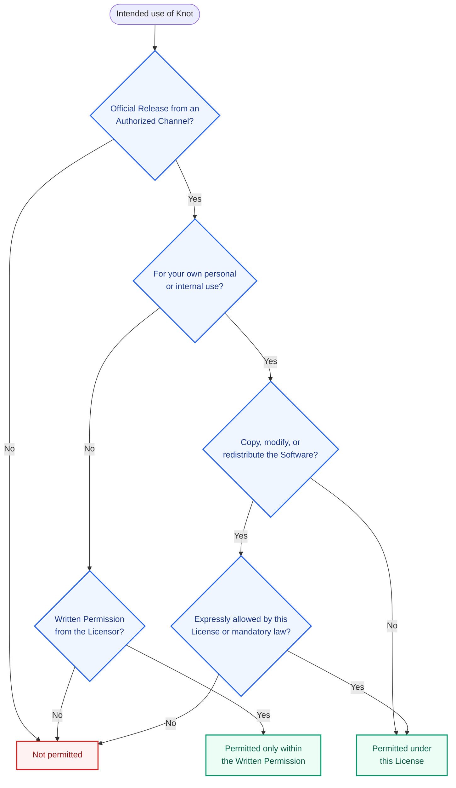

<h1>Knot</h1>

<h3>Proprietary Software License</h3>

<strong>End-User License Agreement &amp; Source Code Protection Notice</strong>

<code>Version 1.0</code> &nbsp;·&nbsp; Effective <strong>7 November 2026</strong>

  
  
  
  

SPDX-License-Identifier: <code>LicenseRef-Proprietary</code> &nbsp;·&nbsp; Not OSI-approved &nbsp;·&nbsp; Not open source

---

> [!IMPORTANT]
> **Knot is proprietary software. It is not open source.**
>
> You may install and use Official Releases for your own tasks under the terms below. You may not copy, modify, reuse, redistribute, or commercially exploit the Software or its Source Code without prior Written Permission from the Licensor. All rights not expressly granted are reserved.

## Document Control

| Field | Details |
|:---|:---|
| **Document** | Knot Proprietary Software License |
| **Version** | 1.0 |
| **Effective date** | 7 November 2026 |
| **Licensor** | Farokh RashidAhmadi |
| **Copyright** | © 2026 Farokh RashidAhmadi. All rights reserved. |
| **Software** | Knot — Android task and reminder application |
| **Scope** | Application builds, Source Code, documentation, designs, and branding |
| **Status** | Proprietary · All rights reserved · Not open source |
| **Contact** | [github.com/farokh-ra](https://github.com/farokh-ra) |
| **Supersedes** | All prior license versions for the Software |

## Contents

| Terms of use | Risk & protection | Governance |
|:---|:---|:---|
| [1. Definitions](#1-definitions) | [7. Third-Party Components](#7-third-party-components) | [13. Mandatory Rights and Consumer Protection](#13-mandatory-rights-and-consumer-protection) |
| [2. Ownership and Copyright](#2-ownership-and-copyright) | [8. Updates, Support, and Availability](#8-updates-support-and-availability) | [14. Governing Law and Disputes](#14-governing-law-and-disputes) |
| [3. Grant of Limited License](#3-grant-of-limited-license) | [9. Term and Termination](#9-term-and-termination) | [15. Changes to This License](#15-changes-to-this-license) |
| [4. Conditions of Permitted Use](#4-conditions-of-permitted-use) | [10. Disclaimer of Warranties](#10-disclaimer-of-warranties) | [16. General Provisions](#16-general-provisions) |
| [5. Restrictions](#5-restrictions) | [11. Limitation of Liability](#11-limitation-of-liability) | [17. Acceptance](#17-acceptance) |
| [6. Source Code and Repository Access](#6-source-code-and-repository-access) | [12. Indemnification](#12-indemnification) | [18. Contact and Permissions](#18-contact-and-permissions) |

## License at a Glance

| Intended action | Status | Conditions |
|:---|:---:|:---|
| Install and use an Official Release for your own tasks | ✅ **Permitted** | Personal or internal use only; this License applies |
| Receive and install official updates | ✅ **Permitted** | Updates form part of the Software |
| Make a private backup copy | ✅ **Permitted** | Archival and recovery only; no distribution; notices retained |
| View the public repository | ⚠️ **Limited** | Viewing grants no right to copy, reuse, or redistribute code |
| Copy, clone, or reuse the Source Code | ❌ **Prohibited** | Prior Written Permission required |
| Modify or create derivative works | ❌ **Prohibited** | Prior Written Permission required |
| Publish, mirror, repackage, or redistribute | ❌ **Prohibited** | Prior Written Permission required |
| Reverse engineer or decompile | ❌ **Prohibited** | Except where mandatory law expressly permits |
| Sell, rent, sublicense, or commercially exploit | ❌ **Prohibited** | Prior Written Permission required |
| Remove copyright or proprietary notices | ❌ **Prohibited** | Notices must remain intact |

> [!NOTE]
> This table is a plain-language summary for convenience only. It is not a substitute for the operative terms below. If the summary and the sections conflict, the sections govern.

## Permitted-Use Decision Path

*Illustrative decision path only. The operative terms in Sections 3–6 control.*

---

## 1. Definitions

In this License, the following terms have the meanings set out below. Defined terms apply to the singular and the plural, and to the Software as a whole and in any part.

| Term | Meaning |
|:---|:---|
| **Licensor** | farokh-ra, the copyright holder and publisher of the Software, together with any successor or permitted assignee. |
| **Software** | The Knot application, including all Official Releases, builds, versions, updates, patches, documentation, and accompanying materials made available by the Licensor, but excluding Third-Party Components. |
| **Source Code** | The human-readable form of the Software, including source files, build scripts, configuration, architecture, algorithms, data models, implementation notes, and any non-public materials relating to the Software. |
| **Official Release** | A build of the Software that the Licensor has published or expressly authorized for distribution through an Authorized Channel. |
| **Authorized Channel** | The Licensor's GitHub repository and releases page, and any other distribution channel that the Licensor designates in writing. |
| **Third-Party Components** | Libraries, frameworks, SDKs, fonts, icons, and other materials owned by third parties and incorporated into or used with the Software. |
| **Written Permission** | A prior, explicit authorization issued by the Licensor. A public repository, silence, the absence of enforcement, or an informal general statement does not constitute Written Permission. |
| **Licensor's Jurisdiction** | The country and, where applicable, the state or province in which the Licensor resides or has its principal place of business as of the effective date of this License. |
| **You** | The individual or legal entity installing, accessing, or using the Software. If you act on behalf of an organization, "you" includes that organization. |

## 2. Ownership and Copyright

**2.1 Licensed, not sold.** The Software is licensed to you, not sold. No title, ownership, or proprietary interest in the Software is transferred to you.

**2.2 Exclusive ownership.** The Licensor owns and reserves all rights, title, and interest in and to the Software, including all copyright, trademark, trade-secret, design, database, and other intellectual-property rights, whether registered or unregistered, and all goodwill associated with them.

**2.3 Protected elements.** The Licensor's rights extend to the Software in source and object form, in whole and in part, including:

| Protected element | Examples |
|:---|:---|
| **Code** | Source code, object code, build scripts, configuration, and dependencies controlled by the Licensor |
| **Architecture** | Software structure, data models, algorithms, logic, and technical implementation |
| **Experience** | User interface, user experience, layouts, flows, and interaction design |
| **Visual assets** | Graphics, icons, artwork, themes, and other original visual materials |
| **Documentation** | Original written materials, guides, and technical documentation |
| **Brand** | Names, logos, marks, and other identifying elements of the project |
| **Derivatives** | Modifications, updates, improvements, and extensions created by the Licensor |

**2.4 No implied rights.** No license or right is granted by implication, estoppel, waiver, course of dealing, or otherwise, except as expressly stated in this License. All rights not expressly granted are reserved.

## 3. Grant of Limited License

**3.1 Limited grant.** Subject to your complete and ongoing compliance with this License, the Licensor grants you a limited, personal, non-exclusive, non-transferable, non-sublicensable, and revocable license, as provided in Section 9, to:

1. download and install Official Releases on devices that you own or control;
2. use those Official Releases for your own personal or internal productivity purposes;
3. make a reasonable number of backup copies solely for private archival and recovery, provided that the copies are not distributed and all proprietary notices are retained; and
4. receive and install updates that the Licensor publishes through Authorized Channels.

**3.2 Personal and internal use.** Using the Software to manage your own tasks, including in the course of your employment or the operation of a business, is permitted. Commercializing the Software itself is not. For example, you may not sell the Software, bundle it into a paid product, or offer it to others as a hosted or managed service without Written Permission.

**3.3 No commercial exploitation of the Software.** This License does not grant any right to commercialize the Software itself, to provide the Software as a service to third parties, or to incorporate the Software into any product or service that you offer to others.

> **This is a license, not a sale.** Installing the Software does not give you ownership of it, access to its Source Code, or any right to use it beyond the limited permissions in this Section.

## 4. Conditions of Permitted Use

Your rights under this License are conditional on your compliance with all of the following:

1. **Notices.** You must keep all copyright, trademark, and proprietary notices on the Software and any permitted copies intact and unaltered.
2. **Authorized sources.** You must obtain Official Releases only from Authorized Channels. Builds from any other source are not licensed under this License.
3. **Legal compliance.** You must use the Software in compliance with all applicable laws, including export-control and sanctions laws, and with the terms of any platform through which you access it.
4. **No circumvention.** You must not bypass, disable, or interfere with any access control, license check, or technical protection measure used in connection with the Software.
5. **Authority.** You must be legally capable of entering into this License. If you accept it on behalf of an organization, you must have authority to bind that organization.

## 5. Restrictions

Except as expressly permitted by this License or by mandatory applicable law, you must not:

- **Copying and distribution** — copy, reproduce, publish, distribute, mirror, sublicense, sell, rent, lease, lend, or otherwise make the Software available to any third party.
- **Modification** — modify, adapt, translate, or alter the Software, in whole or in part.
- **Derivative works** — create derivative works based on the Software, its Source Code, its design, or its protected elements.
- **Reverse engineering** — reverse engineer, decompile, disassemble, or attempt to derive the Source Code, except to the extent that applicable law expressly permits and cannot be excluded.
- **Source reuse** — extract, reuse, or incorporate the Source Code, algorithms, architecture, user interface, visual assets, or documentation into another product, project, or service.
- **Commercial exploitation** — sell, resell, license, sublicense, bundle, or otherwise commercially exploit the Software, or use it to provide a service to third parties, without Written Permission.
- **Unofficial builds** — distribute, publish, or promote modified, repackaged, or unofficial builds of the Software.
- **Notices** — remove, obscure, or alter any copyright, trademark, or proprietary notice.
- **Branding** — use the Software's name, logo, or branding in a way that states or implies endorsement, partnership, sponsorship, or official status without Written Permission, except for accurate descriptive references permitted by law.
- **Misrepresentation** — claim authorship or ownership of the Software, present the Software as independently developed by you or another party, or register confusingly similar names or marks.
- **Unlawful use** — use the Software in violation of applicable law or the rights of any third party.
- **Circumvention** — circumvent or attempt to circumvent any technical restriction, access control, or license-enforcement mechanism.

**5.1 Scope.** These restrictions apply to the Software in whole and in part, in source and object form, and to all copies, extracts, and permitted backups.

**5.2 Security research.** Nothing in this Section prohibits good-faith security research that is protected by applicable law or authorized in writing by the Licensor. If you discover a security issue, please report it responsibly through the contact channel in Section 18.

## 6. Source Code and Repository Access

**6.1 Public visibility is not permission.** The Software's repository may be publicly accessible. Public visibility, repository accessibility, or the availability of source files through GitHub or any other platform does not make the Software open source and does not grant you any right to use, copy, modify, or distribute the Source Code.

**6.2 No source license.** This License does not grant any right to clone, fork, download, copy, compile, modify, distribute, or reuse the Source Code for any purpose beyond viewing the repository through the platform and any rights that applicable platform terms or mandatory law independently grant. Those independent rights are not expanded by this License.

**6.3 Platform terms.** Your access to the repository is also subject to the terms of the platform hosting it, including GitHub's Terms of Service. To the extent those terms grant you rights in public repository content, those rights are governed by those terms. Any use of the Source Code outside the platform requires Written Permission.

> [!WARNING]
> Viewing a public repository does not give you a license to its code. If you want to use any part of the Source Code — including for a personal, educational, or non-commercial project — you must obtain Written Permission first.

**6.4 No waiver by non-enforcement.** The Licensor's failure to enforce this Section in any instance is not a waiver of its rights in that or any other instance.

## 7. Third-Party Components

**7.1 Separate licenses.** The Software may incorporate Third-Party Components. Those components remain subject to the copyright and license terms of their respective owners. This License does not grant you any rights in those components beyond what their own licenses allow.

**7.2 No override.** This License does not override, restrict, or replace any rights granted to you under a third-party license. If this License conflicts with a third-party license as applied to that component, the third-party license controls for that component.

**7.3 Not open source.** The presence of open-source Third-Party Components in or with the Software does not make the Software, as a whole, open source or freely reusable.

**7.4 Attribution.** Where required, third-party copyright notices and attribution information are maintained in the repository, the application, or the distribution materials. You must not remove them from any permitted copy.

## 8. Updates, Support, and Availability

**8.1 No obligation.** The Licensor is not obligated to provide updates, upgrades, patches, maintenance, technical support, or new features.

**8.2 Changes and discontinuation.** The Licensor may modify, suspend, or discontinue the Software or any feature, release, or distribution channel at any time, subject to applicable law.

**8.3 Updates.** Updates are part of the Software and are governed by this License unless they are accompanied by separate terms. Installing an update indicates your acceptance of the then-current License.

**8.4 No availability guarantee.** The Licensor does not guarantee that the Software, any release, or any distribution channel will remain available, supported, or compatible with any particular device or operating-system version.

**8.5 Your responsibility.** You are responsible for maintaining independent backups of your data and for ensuring that your device and operating system are compatible with the Software.

## 9. Term and Termination

**9.1 Term.** This License is effective from the date you first install, access, or use the Software and continues until terminated.

**9.2 Termination for breach.** This License terminates automatically if you materially breach it. The Licensor may also terminate this License by written notice if you breach it and fail to cure the breach within a reasonable period after receiving notice, or immediately if the breach cannot be cured.

**9.3 Effect of termination.** On termination, you must stop all use of the Software and delete or destroy all copies in your possession or control, including backups, except to the extent that applicable law requires you to retain them. The Licensor may request written confirmation that this has been done.

**9.4 Survival.** Sections 2, 5, 6, 10, 11, 12, 13, 14, 16, and any other provision that by its nature should survive termination will survive.

**9.5 Remedies.** Termination is in addition to, and not in place of, any other remedies available to the Licensor under this License or applicable law.

## 10. Disclaimer of Warranties

> **THE SOFTWARE IS PROVIDED "AS IS" AND "AS AVAILABLE", WITH ALL FAULTS AND WITHOUT WARRANTY OF ANY KIND. TO THE MAXIMUM EXTENT PERMITTED BY APPLICABLE LAW, THE LICENSOR EXPRESSLY DISCLAIMS ALL WARRANTIES, WHETHER EXPRESS, IMPLIED, STATUTORY, OR OTHERWISE, INCLUDING ANY IMPLIED WARRANTIES OF MERCHANTABILITY, FITNESS FOR A PARTICULAR PURPOSE, TITLE, QUIET ENJOYMENT, ACCURACY, AND NON-INFRINGEMENT.**

**10.1 No guarantees.** The Licensor does not warrant that the Software will operate without interruption, be free of errors, defects, or harmful components, remain compatible with any device or operating system, meet your requirements, or remain available or supported.

**10.2 Reminders and alarms.** You acknowledge that reminder and alarm delivery depends on Android, device-manufacturer settings, permissions, battery-optimization policies, network conditions, and other factors outside the Licensor's control. Notifications may be delayed, suppressed, or fail. The Software is not a life-safety, medical, emergency, or other critical-use system, and you must not rely on it for time-critical or safety-critical purposes.

**10.3 Data.** The Licensor does not guarantee the storage, integrity, or availability of your data. You are responsible for maintaining independent backups.

**10.4 No advice.** No oral or written information or advice provided by the Licensor creates a warranty or expands the scope of this License.

**10.5 Mandatory rights.** Some jurisdictions do not allow the exclusion of certain warranties. In that case, the exclusions above apply to the maximum extent permitted, and Section 13 governs.

## 11. Limitation of Liability

> **TO THE MAXIMUM EXTENT PERMITTED BY APPLICABLE LAW, IN NO EVENT SHALL THE LICENSOR BE LIABLE FOR ANY INDIRECT, INCIDENTAL, SPECIAL, EXEMPLARY, PUNITIVE, OR CONSEQUENTIAL DAMAGES, OR FOR ANY LOSS OF PROFITS, REVENUE, DATA, GOODWILL, BUSINESS, OR ANTICIPATED SAVINGS, ARISING OUT OF OR RELATING TO THE SOFTWARE OR THIS LICENSE, REGARDLESS OF THE CAUSE OF ACTION OR WHETHER THE LICENSOR WAS ADVISED OF THE POSSIBILITY OF SUCH DAMAGES.**

**11.1 Aggregate cap.** To the maximum extent permitted by law, the Licensor's total aggregate liability arising out of or relating to the Software or this License will not exceed the total amount you paid to the Licensor for the Software during the twelve months preceding the event giving rise to the claim. Because the Software is provided free of charge, that amount may be zero.

**11.2 Mandatory liability.** Nothing in this License excludes or limits liability that cannot be excluded or limited by applicable law, including liability for death or personal injury caused by negligence, fraud or fraudulent misrepresentation, or willful misconduct.

**11.3 Allocation of risk.** You acknowledge that the disclaimers and limitations in this License reflect a reasonable allocation of risk and are a fundamental basis for the Licensor making the Software available without charge.

## 12. Indemnification

To the extent permitted by applicable law, you agree to indemnify, defend, and hold harmless the Licensor from and against any claims, damages, losses, liabilities, costs, and reasonable legal fees arising out of or relating to:

1. your breach of this License;
2. your misuse of the Software; or
3. your violation of applicable law or the rights of any third party,

except to the extent that the claim is caused by the Licensor's negligence, willful misconduct, or breach of this License. The Licensor will promptly notify you of any such claim and may participate in the defense. You may not settle a claim in a way that admits liability on the part of the Licensor without the Licensor's prior written consent.

## 13. Mandatory Rights and Consumer Protection

**13.1 No exclusion of mandatory rights.** Nothing in this License excludes, restricts, or waives any right you have under mandatory consumer-protection, warranty, or other applicable law that cannot be excluded, restricted, or waived by agreement.

**13.2 Consumer rights.** If you are a consumer, you may have additional statutory rights in your country of residence. This License is subject to those rights. In the event of a conflict, mandatory applicable law prevails over this License.

**13.3 Severability of invalid terms.** If any provision of this License is found to be invalid, illegal, or unenforceable, that provision will be enforced to the maximum extent permitted by law, and the remaining provisions will remain in full force and effect.

## 14. Governing Law and Disputes

**14.1 Governing law.** This License is governed by the laws of the Licensor's Jurisdiction, without regard to its conflict-of-law rules. The United Nations Convention on Contracts for the International Sale of Goods does not apply.

**14.2 Venue.** Subject to any mandatory right you may have to bring a claim in your local courts, the courts of the Licensor's Jurisdiction will have exclusive jurisdiction over any dispute arising out of or relating to this License or the Software.

**14.3 Informal resolution.** Before filing a formal claim, you agree to contact the Licensor and attempt in good faith to resolve the dispute for at least thirty (30) days. This does not prevent either party from seeking urgent injunctive or other equitable relief.

**14.4 Injunctive relief.** The Licensor may seek injunctive or other equitable relief in any competent court to protect its intellectual-property rights, without the need for a bond or other security to the extent permitted by law.

**14.5 Language.** This License is written in English. Any translation is provided for convenience only, and the English version controls in the event of a conflict.

## 15. Changes to This License

**15.1 Revisions.** The Licensor may revise this License from time to time. A revised version will be published in the official repository with a new version number and effective date.

**15.2 When changes apply.** The version in effect when you install a release governs your use of that release. If you install an update or continue to use the Software after a revised version takes effect, the revised version governs your continued use.

**15.3 Right to decline.** If you do not accept a revised version, you must stop using the Software and delete all copies in your possession or control.

**15.4 No retroactive effect.** Revisions apply prospectively from their effective date and do not retroactively alter rights or obligations that accrued before that date, except as required by applicable law.

**15.5 Current version.** The current version of this License supersedes all earlier versions and any prior license terms for the Software.

## 16. General Provisions

**16.1 Entire agreement.** This License is the entire agreement between you and the Licensor regarding the Software and supersedes all prior or contemporaneous agreements, representations, and understandings, whether written or oral. Third-party licenses and platform terms remain applicable as described in this License.

**16.2 No waiver.** A failure or delay by the Licensor in exercising any right under this License is not a waiver of that right or any other right.

**16.3 Assignment.** You may not assign or transfer this License or any rights under it without the Licensor's prior Written Permission. The Licensor may assign this License to a successor or in connection with a merger, acquisition, or sale of all or substantially all of its assets.

**16.4 No third-party beneficiaries.** Except for the Licensor and its successors and permitted assigns, this License does not create any third-party beneficiary rights.

**16.5 Independent parties.** The parties are independent. Nothing in this License creates a partnership, joint venture, agency, employment, or fiduciary relationship.

**16.6 Force majeure.** The Licensor is not liable for any delay or failure to perform caused by events beyond its reasonable control, including natural disasters, outages, labor disputes, or governmental action.

**16.7 Construction.** Headings are for convenience only and do not affect interpretation. "Including" means "including without limitation." "Or" is not exclusive. References to "days" mean calendar days unless stated otherwise.

**16.8 Survival.** The provisions of this License that by their nature should survive termination will survive, including provisions concerning ownership, restrictions, disclaimers, liability, indemnification, and governing law.

## 17. Acceptance

**17.1 Binding acceptance.** By downloading, installing, accessing, or using the Software, you acknowledge that you have read and understood this License and agree to be bound by it. If you do not agree, do not install or use the Software, and delete any copies in your possession or control.

**17.2 Organizational acceptance.** If you accept this License on behalf of an organization, you represent that you have the authority to bind that organization to this License.

**17.3 Repository access.** Accessing the public repository solely to view its contents is subject to Section 6 and does not grant any license to the Source Code.

**17.4 Electronic acceptance.** Electronic acceptance, including by installing or using the Software, has the same effect as a handwritten signature to the extent permitted by applicable law.

## 18. Contact and Permissions

**18.1 Permission requests.** Requests for Written Permission — including requests to reuse the Source Code, distribute the Software, or obtain commercial rights — must be sent to the Licensor through the official project profile:

> **GitHub:** [github.com/farokh-ra](https://github.com/farokh-ra)

**18.2 What to include.** Please include your name or organization, the material you wish to use, the intended use, the distribution scope, and the requested duration.

**18.3 No implied permission.** The Licensor may grant or deny a request in its sole discretion. A failure to respond, a public statement, or the absence of enforcement is not permission.

**18.4 Confidentiality.** Do not send confidential or sensitive information through public channels. Ask the Licensor for an appropriate private contact method first.

**18.5 Security reports.** Please report security vulnerabilities responsibly and privately. Do not publicly disclose a vulnerability before the Licensor has had a reasonable opportunity to address it.

---

<h3>Proprietary Software · All Rights Reserved</h3>

<strong>Copyright © 2026 farokh-ra. All rights reserved.</strong>

Knot is proprietary software. No part of the Software may be copied, modified, distributed, sublicensed, or exploited except as expressly permitted by this License or by mandatory applicable law.

<code>Knot Proprietary Software License · Version 1.0 · Effective 7 November 2026</code>

<strong>END OF LICENSE</strong>

