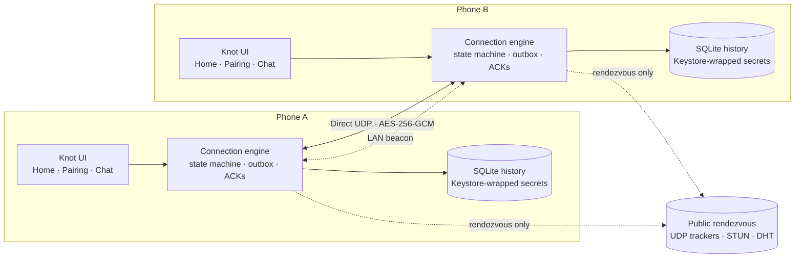

<div align="center">

# Knot

**Private, serverless, end-to-end encrypted messaging for exactly two people.**

A small Android app that lets two trusted devices talk directly over the internet — with no
account system, no messaging backend, no cloud database, no relay and no analytics.

[](https://developer.android.com)
[](https://kotlinlang.org)
[](https://github.com/farokh-ra/KNOT)
[](docs/TESTING.md)
[](#privacy-by-design)
[](https://github.com/farokh-ra/KNOT/stargazers)

[Overview](#overview) · [Features](#features) · [How it works](#how-it-works) ·
[Security](#security-model) · [Build](#build-from-source) · [Install](#install) ·
[Documentation](#documentation) · [Limitations](#limitations)

</div>

---

> **Project status — v1.0.0**
> The app compiles and the 48-test JVM suite passes. The release signing path is documented
> and produces a signed APK when the local keystore is present. No prebuilt release artifact
> is published in this repository — build it locally with the included Gradle wrapper.
> On-device installation, QR scanning and the two-phone network matrix still need to be
> exercised on physical hardware. See [`docs/TESTING.md`](docs/TESTING.md) for the exact
> verification record and the test matrix to complete.

## Overview

Knot is a deliberately small messenger for **one private conversation between two devices**.
It is built around a simple rule: if the two phones cannot reach each other directly, the app
says so. It never silently routes a message through a third party.

Public infrastructure — BitTorrent-DHT bootstrap nodes, UDP trackers and STUN servers — is
used **only for rendezvous**, to help the two devices discover each other's UDP endpoint.
Chat traffic travels over a direct, authenticated, encrypted peer connection. There is no
server component in this repository and no hosted service operated for the app.

| | |
|---|---|
| **App name** | Knot |
| **Package** | `dev.twoperson.messenger` |
| **Version** | 1.0.0 (versionCode 1) |
| **Platform** | Android 8.0 (API 26) and newer |
| **Language** | Kotlin 2.0.21 |
| **Build** | Gradle 8.11.1 · Android Gradle Plugin 8.7.3 |
| **Transport** | Direct UDP · AES-256-GCM |
| **Backend** | None |
| **Build output** | `app/build/outputs/apk/` (debug and release) |

### Why another messenger?

Most messengers ask you to trust a server. Knot removes that server from the conversation.
The trade-off is honest and visible: direct-only peer-to-peer networking cannot cross every
NAT, firewall or carrier-grade NAT. When a path does not exist, Knot reports
**“Unable to connect directly”** instead of falling back to a relay.

## Features

| | Feature | What it means |
|---|---|---|
| **Pair once** | 32-byte invitation secret | One person creates an invitation; the other scans the QR code or pastes the `TPM1-…` code. |
| **Serverless discovery** | UDP trackers + DHT + LAN beacon | Both devices derive a rendezvous topic from the invitation and find each other without an account server, even on networks that block the usual DHT ports. |
| **Direct connection** | UDP hole punching | Peers authenticate and talk directly; no TURN, relay or message-forwarding path exists in the codebase. |
| **End-to-end encryption** | X25519 + HKDF + AES-256-GCM | Fresh ephemeral keys per session, authenticated handshake, per-direction nonces and a replay window. |
| **Reliable messaging** | Local outbox + ACKs | Messages are stored before sending, retried after reconnection and acknowledged only after the peer stores them. |
| **Duplicate suppression** | Stable message IDs | A resent message is acknowledged again but never displayed twice. |
| **Background link** | `dataSync` foreground service | The connection survives screen-off and app backgrounding, with an ongoing notification that mirrors the real state. |
| **Local history** | SQLite in the app sandbox | History survives restarts. Clearing app data or uninstalling removes it permanently. |
| **Honest failures** | Explicit connection states | The UI shows discovering, connecting, connected, disconnected and unable-to-connect states. |
| **No telemetry** | No analytics or crash SDK | No account, no tracking, no message content leaves the two devices except over the encrypted peer link. |

### What Knot deliberately does **not** do

No group chats, file transfer, voice or video calls, cloud backup, push notifications, read
receipts, typing indicators, contact discovery, accounts, phone-number login or message relay.
Version 1 is intentionally one conversation between two devices.

## How it works

### 1. Pairing

1. Phone A generates a **32-byte invitation secret** with `SecureRandom`.
2. The secret is encoded as a copyable `TPM1-XXXX-XXXX-…` code and a QR code.
3. Phone B scans or pastes the code.
4. Both devices derive the same values locally:

```text
authKey = HMAC-SHA256(secret, "tpmsg/v1/auth")
topic   = HMAC-SHA256(authKey, "tpmsg/v1/topic")[0..19]
```

The raw secret is **never published**. Only the derived 20-byte topic reaches the DHT and the
public trackers.

### 2. Discovery

Discovery has four independent paths, all sharing the same UDP socket:

1. **UDP trackers (BEP 15)** on HTTP/HTTPS ports (80/443). Both devices announce the derived
   topic and read each other's public endpoint back. This keeps discovery working on carriers
   that block the DHT's port 6881.
2. **STUN** learns the NAT's translated port for the shared socket, so the tracker announce
   publishes the port peers should actually dial.
3. **BitTorrent mainline DHT** (BEP 5 `get_peers` / `announce_peer`) on the derived topic.
4. **LAN beacon** on UDP port 41999 for the same-Wi-Fi case.

These services learn a derived topic hash and your public IP/UDP port while the app is open —
nothing else. Incoming authenticated handshakes are accepted at any time, not only while this
side is dialing, so one-sided discovery still connects.

### 3. Direct connection

Peers send authenticated X25519 handshake packets to the endpoint they discovered. The
handshake proves possession of the invitation secret, binds the peer's static identity key
into the transcript, and derives fresh session keys. Chat then travels as AES-256-GCM frames
over the same UDP socket used for discovery, so the NAT mapping stays valid.

If no direct path exists, the app keeps retrying and displays **“Unable to connect directly”**.
It does not fall back to a relay.

### 4. Messaging

Outgoing messages are persisted as `PENDING` **before** any network send. The reliable layer
chunks each message into encrypted frames, acknowledges them cumulatively with a selective
bitmap, retransmits with exponential backoff, and delivers strictly in order. When the peer
has stored the message, it returns an application-level `ACK` and the sender marks it
**Received by peer**. A message that cannot be delivered stays on the sender and is retried
with the same ID on the next connection.

## Architecture



| Layer | Responsibility |
|---|---|
| **UI** | Three Material 3 screens: Home, Pairing and Chat; QR generation and scanning. |
| **Service** | A `dataSync` foreground service owns the engine lifetime so the link survives backgrounding. |
| **Engine** | Connection state machine, discovery loop, outbox, acknowledgements, network-change handling and reconnect backoff. |
| **Protocol** | Versioned binary schema with strict validation, chunking and bounded reassembly. |
| **Transport** | One UDP socket, authenticated handshake, encrypted reliable frames and heartbeats. |
| **Discovery** | BEP 15 UDP-tracker rendezvous, STUN public-endpoint lookup, minimal mainline-DHT client and a same-subnet LAN beacon. |
| **Storage** | SQLite message history, pinned peer identity and Keystore-wrapped secrets. |
| **Crypto** | X25519, HKDF-SHA256, HMAC-SHA256 and AES-256-GCM. |

The full design is documented in [`docs/ARCHITECTURE.md`](docs/ARCHITECTURE.md), and the exact
wire format is in [`docs/PROTOCOL.md`](docs/PROTOCOL.md).

## Security model

Knot assumes the network is hostile: packets can be observed, injected, replayed, dropped or
reordered. Public DHT nodes, UDP trackers and STUN servers are untrusted infrastructure. The
invitation is exchanged out-of-band with the intended person.

| Property | Implementation |
|---|---|
| **Key exchange** | X25519 (RFC 7748) with fresh ephemeral keys for every session |
| **Key derivation** | HKDF-SHA256 with a transcript-bound salt |
| **Peer authentication** | HMAC-SHA256 keyed by the invitation-derived `authKey`, plus a confirmation MAC |
| **Transport encryption** | AES-256-GCM; per-direction counters as nonces; 128-frame replay window |
| **Forward secrecy** | Session keys come from ephemeral X25519 keys; the long-term identity key signs into the transcript but never encrypts messages |
| **Identity pinning** | The peer's static X25519 identity is pinned after the first successful pairing; a changed identity is rejected |
| **Secret storage** | The identity private key and invitation secret are wrapped with a non-exportable AES key held in the Android Keystore |
| **Discovery privacy** | Only the HMAC-derived 20-byte topic is published to DHT nodes and trackers; STUN only reflects the socket's public endpoint. The invitation secret is never published |
| **Relay** | None. There is no relay, TURN or forwarding code path anywhere in the project |

### Honest gaps

- The handshake is a custom Noise-XX-style construction (X25519 + HMAC + HKDF + confirmation
  MAC). It is covered by unit tests and RFC 7748 vectors, but it has **not** been externally
  audited and is not the Noise protocol implementation itself.
- Pairing is **trust-on-first-use**. If someone obtains the invitation before the intended
  person pairs, they can become the first peer. Invitations do not expire; replacing the
  invitation or using *Forget partner* is manual.
- Message history is **not encrypted at rest**. It is plain SQLite inside the app sandbox;
  the identity key and invitation secret are wrapped, but message text is not.
- While the app is open, DHT nodes, UDP trackers, STUN servers and the other device learn your
  public IP and UDP port. This is inherent to serverless rendezvous.
- A compromised device, rooted phone, screenshot malware or a malicious keyboard is outside
  the threat model.

Read the full threat model and checklist in [`docs/SECURITY.md`](docs/SECURITY.md).

## Tech stack

| Area | Choice |
|---|---|
| Language | Kotlin 2.0.21 |
| UI | Android Views, Material 3, ViewBinding |
| Concurrency | Kotlin Coroutines and `StateFlow` |
| Networking | Raw UDP (`DatagramSocket`), custom reliable link |
| Discovery | BEP 15 UDP trackers, RFC 5389 STUN, BitTorrent mainline DHT (BEP 5), LAN broadcast beacon |
| Cryptography | `java.security` / `javax.crypto`: X25519, HKDF-SHA256, HMAC-SHA256, AES-256-GCM |
| Storage | SQLite (`SQLiteOpenHelper`), Android Keystore |
| QR | ZXing core + `zxing-android-embedded` (no Play Services) |
| Build | Gradle 8.11.1, AGP 8.7.3, JDK 17+ |
| Tests | JUnit 4, `kotlinx-coroutines-test`, real loopback UDP |

## Build from source

### Requirements

- **JDK 17 or newer** (the recorded artifacts were built with Temurin 21.0.13+9).
- **Android SDK** with **platform 34** and **build-tools 34.0.0**.
- No NDK, Android Studio, Node.js or Expo toolchain is required. The Gradle wrapper is
  included.

### Clone and configure

```bash
git clone https://github.com/farokh-ra/KNOT.git
cd KNOT
```

Point Gradle at your Android SDK by creating `local.properties` (git-ignored):

```properties
sdk.dir=/path/to/Android/Sdk
```

On Windows, escape the path:

```properties
sdk.dir=C\:\\Users\\you\\AppData\\Local\\Android\\Sdk
```

### Build and test

**Windows (PowerShell):**

```powershell
$env:JAVA_HOME = "C:\path\to\jdk-17-or-newer"

.\gradlew.bat :app:testDebugUnitTest      # 48 JVM tests
.\gradlew.bat :app:assembleDebug          # debug APK
.\gradlew.bat :app:assembleRelease        # signed release APK
```

**macOS / Linux:**

```bash
export JAVA_HOME=/path/to/jdk-17-or-newer

./gradlew :app:testDebugUnitTest
./gradlew :app:assembleDebug
./gradlew :app:assembleRelease
```

Build outputs:

```text
app/build/outputs/apk/debug/app-debug.apk
app/build/outputs/apk/release/app-release.apk
```

### Release signing

Release signing is read from `signing/keystore.properties`, which is **git-ignored**:

```properties
storeFile=signing/release.jks
storePassword=…
keyAlias=twoperson
keyPassword=…
```

If the file is missing, `assembleRelease` produces an **unsigned** APK instead of silently
falling back to a debug key. To create a fresh key:

```bash
keytool -genkeypair -keystore signing/release.jks -storetype JKS -alias twoperson \
  -keyalg RSA -keysize 4096 -validity 10950 \
  -dname "CN=Two-Person Messenger, OU=Android, O=Two Person Messenger, L=Local, ST=Local, C=US"
```

Reusing the same signing key matters: a different key means the installed app cannot be
upgraded in place. Never commit the keystore or its passwords.

Full build and verification details: [`docs/BUILD.md`](docs/BUILD.md).

## Install

Build an APK locally with the included Gradle wrapper.

For a quick local install, use the debug build:

```bash
./gradlew :app:assembleDebug
adb install -r app/build/outputs/apk/debug/app-debug.apk
```

For a signed release build, configure `signing/keystore.properties` first (see above), then:

```bash
./gradlew :app:assembleRelease
adb install -r app/build/outputs/apk/release/app-release.apk
```

Or copy the APK to the phone and open it from the Files app. The APK is a single universal
build with no native libraries, so it runs on arm64, arm32 and x86 devices with Android 8.0+.

- Camera permission is requested only when you tap **Scan QR code**; you can always paste the
  invitation code instead.
- Samsung/One UI adds extra sideloading gates. See
  [`docs/INSTALL.md`](docs/INSTALL.md) for Auto Blocker, Play Protect and
  unknown-sources troubleshooting.
- The debug and release builds share the same application ID but use different signing keys,
  so uninstall one before installing the other.

## Usage

1. **Create an invitation** on phone A. A QR code and a `TPM1-…` code appear.
2. **Join the invitation** on phone B: scan the QR code or paste the code, then tap **Join**.
3. Keep both apps running. A foreground service holds the direct link with an ongoing
   notification, so the screen can be off.
4. The home screen shows **Searching…**, then **Connected — direct over the internet** or
   **Connected — direct on the local network**.
5. Open the chat and type. Message states are:

| State | Meaning |
|---|---|
| **Queued** | Stored locally; not yet handed to a connected peer |
| **Sent to peer** | The peer's transport stack acknowledged the bytes |
| **Received by peer** | The peer stored the message and returned an application-level ACK |
| **Not delivered** | The link closed before delivery; the message is kept and retried on the next connection |

The chat subtitle shows **`direct · encrypted`** while the channel is up.

Use **Clear conversation** to delete local history (the pairing survives), or **Forget
partner** to remove the invitation and require a new pairing.

## Testing

```bash
./gradlew :app:testDebugUnitTest
```

The JVM suite contains **53 tests** across crypto, protocol, DHT encoding, STUN, BEP 15
trackers, secure channel, handshake and a full loopback-UDP peer link. The tests use real
sockets and real crypto, not mocks.

| Test class | Focus |
|---|---|
| `crypto.X25519Test` | RFC 7748 vectors, low-order point rejection, key agreement |
| `crypto.CryptoTest` | HKDF-SHA256 RFC 5869 vector, AES-GCM round trip, tamper rejection |
| `crypto.InviteTest` | Invitation round trip, malformed codes, deterministic derived topic |
| `protocol.AppCodecTest` | Schema round trips, UTF-8 and length validation, unknown types |
| `protocol.ChunkingTest` | Out-of-order reassembly, duplicates, bounds and expiry |
| `net.SecureChannelTest` | Encrypted frames, replay detection, tampering and truncation |
| `net.HandshakeTest` | Mirrored keys, wrong invitation, tampered MAC, idempotent retransmission |
| `net.PeerLinkTest` | Full loopback UDP link, bidirectional traffic, heartbeats, spoof resistance, incoming-only responder |
| `net.dht.BencodeTest` | Nested bencode round trip, canonical order, malformed input |
| `net.rendezvous.StunClientTest` | XOR-MAPPED-ADDRESS parsing, forged-transaction rejection |
| `net.rendezvous.TrackerRendezvousTest` | Real BEP 15 connect/announce format, compact peer parsing, announce throttle |

The build and artifact checks are recorded in [`docs/TESTING.md`](docs/TESTING.md), along with
the **two-phone test matrix** that still needs to be completed on physical hardware. No
emulator or physical device was attached to the build machine, so installation, QR scanning
and real-world NAT traversal remain to be verified by the user.

## Project structure

```text
KNOT/
├── app/
│   └── src/
│       ├── main/
│       │   ├── java/dev/twoperson/messenger/
│       │   │   ├── crypto/       X25519, HKDF/HMAC, AES-GCM, invitations, topics
│       │   │   ├── protocol/     Versioned schema, validation, chunking, reassembly
│       │   │   ├── net/          UDP transport, handshake, secure channel, reliable link
│       │   │   ├── net/dht/      Bencode and minimal mainline-DHT rendezvous client
│       │   │   ├── net/rendezvous/  BEP 15 UDP trackers, STUN, shared-socket rendezvous
│       │   │   ├── data/         SQLite history, pinned identity, Keystore-backed secrets
│       │   │   ├── engine/       Connection state machine, discovery, outbox, ACKs
│       │   │   ├── service/      Foreground service that holds the link open
│       │   │   └── ui/           Home, Pairing and Chat screens
│       │   └── res/              Material 3 layouts, theme, adaptive icon
│       └── test/                 53 JVM tests (crypto, protocol, rendezvous, loopback link)
├── docs/                         Architecture, protocol, security, testing, build, install
├── gradle/                       Gradle wrapper
├── signing/                      Local signing material (git-ignored)
├── build.gradle.kts
├── settings.gradle.kts
├── gradle.properties
├── LIMITATIONS.md
├── roadmap.md
└── README.md
```

## Documentation

| Document | Contents |
|---|---|
| [`docs/ARCHITECTURE.md`](docs/ARCHITECTURE.md) | Layers, connection state machine, message flow, reliability and persistence |
| [`docs/PROTOCOL.md`](docs/PROTOCOL.md) | Exact wire formats: invitation, handshake, frames, chunks and application messages |
| [`docs/SECURITY.md`](docs/SECURITY.md) | Threat model, security checklist and honest gaps |
| [`docs/TESTING.md`](docs/TESTING.md) | Verified results, test matrix and on-device functional checks |
| [`docs/BUILD.md`](docs/BUILD.md) | Toolchain, build commands, signing and APK verification |
| [`docs/INSTALL.md`](docs/INSTALL.md) | Installing on a phone, including Samsung/One UI troubleshooting |
| [`docs/ROADMAP_DEVIATIONS.md`](docs/ROADMAP_DEVIATIONS.md) | How this native Kotlin build maps to `roadmap.md` |
| [`LIMITATIONS.md`](LIMITATIONS.md) | What the app cannot do, stated plainly |
| [`roadmap.md`](roadmap.md) | The original product and engineering roadmap |

## Limitations

These are properties of a direct-only, serverless messenger — not bugs to be fixed later by
adding a relay:

- **A direct path cannot exist on every network.** Carrier-grade NAT, symmetric NAT, strict
  corporate firewalls and some VPN combinations block inbound UDP. Knot reports the failure
  and keeps retrying.
- **Discovery needs either the DHT or a tracker/STUN server.** Networks that block all
  outbound UDP cannot discover peers; UDP trackers on ports 80/443 cover the common case where
  only the DHT's port 6881 is blocked.
- **Both people must have the app running.** There is no push notification and no server to
  hold messages. A message sent while the peer is offline stays queued on the sender.
- **Background delivery is best-effort.** A `dataSync` foreground service holds the link while
  the screen is off, but it cannot survive the device being powered off, the app being
  force-stopped, or long Doze/standby periods.
- **History is local and not encrypted at rest.** Clearing app data or uninstalling deletes it
  permanently. There is no backup, export or sync.
- **The handshake is not externally audited.**
- **Metadata is visible to the network.** DHT nodes, UDP trackers, STUN servers and the peer
  see your public IP/port while the app is open.

The complete list is in [`LIMITATIONS.md`](LIMITATIONS.md).

## Roadmap

**Shipped in 1.0.0**

- Native Kotlin Android app with three Material 3 screens.
- Invitation pairing via QR code, paste and scan.
- Direct-only UDP transport with authenticated X25519 handshake and AES-256-GCM frames.
- Public rendezvous: UDP trackers (BEP 15), STUN and DHT, plus a same-subnet LAN beacon.
- Reliable outbox, application acknowledgements, duplicate suppression and reconnect backoff.
- SQLite history, pinned peer identity and Keystore-wrapped secrets.
- Release signing configuration for APK Signature Scheme v2 + v3.

**Next, in priority order**

1. Complete the two-phone network matrix in [`docs/TESTING.md`](docs/TESTING.md).
2. Add invitation expiry/revocation and a clearer re-pairing flow.
3. Evaluate encryption-at-rest for local history.
4. Commission an external review of the handshake construction.
5. Improve accessibility, localization and onboarding polish.

Items are candidates, not commitments. The non-negotiable constraint remains: **no relay and
no server that stores or forwards chat content**.

## Privacy by design

- No analytics, no crash reporting, no accounts and no advertising SDK.
- Message history and the pinned peer identity live in the app's private SQLite database.
- The identity private key and invitation secret are wrapped with a non-exportable AES key
  from the Android Keystore.
- DHT nodes and UDP trackers learn only a derived topic hash plus your IP/port while the app
  is open; STUN sees only the endpoint of the shared socket.
- Chat content is sent only to the one authenticated peer endpoint.
- Clearing app data or uninstalling destroys the local history and the wrapped secrets.

## FAQ

**Is there a server?**
No app-operated server. Public DHT bootstrap nodes, UDP trackers and STUN servers help the two
devices find each other; they never carry chat content.

**Can I use Knot with more than one person?**
No. Version 1 is exactly one private conversation between two paired devices.

**Does it work when the other person is offline?**
No. There is no store-and-forward server. The message stays queued on the sender and is
delivered after the peer reconnects.

**Are messages encrypted?**
Yes, in transit: X25519 key agreement, HKDF-SHA256 key derivation and AES-256-GCM frames.
Local history is not encrypted at rest.

**Why does it say “Unable to connect directly”?**
The two networks cannot establish a direct UDP path. Knot does not use a relay, so this is an
honest failure rather than a silent downgrade.

**Is it on Google Play?**
No. Build the APK from source and install it manually.

**Can I build it myself?**
Yes. See [Build from source](#build-from-source). JDK 17+, Android SDK 34 and the included
Gradle wrapper are all you need.

## Contributing

Contributions are welcome, especially around real-world network testing and documentation.

1. Fork the repository and create a focused branch.
2. Keep the no-relay, no-server constraint intact.
3. Run `./gradlew :app:testDebugUnitTest` before opening a pull request.
4. Never commit signing keys, keystores, passwords, message contents or invitation secrets.
5. Describe the network conditions and devices used for any connectivity change.

For security issues, please report them privately through GitHub's security advisory flow or
contact the maintainer directly instead of opening a public issue with exploit details.

## Author

**Farokh RashidAhmadi** ([@farokh-ra](https://github.com/farokh-ra))

Software developer focused on C#, PHP, HTML, CSS and Windows development — building useful
software, solving problems and always learning something new.

## Disclaimer

Knot is an experimental, independently developed Android application. It has not been
externally audited. Direct-only peer-to-peer networking cannot guarantee connectivity on every
network. Use it for conversations where both people understand and accept those constraints.
The software is provided as-is, without warranty of any kind.

---

<div align="center">

**Knot** — two devices, one private thread.

If this project is useful to you, consider starring the repository.

</div>
