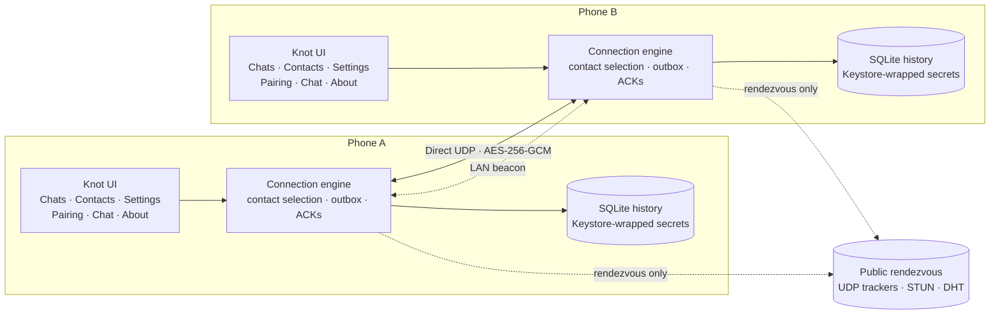

<div align="center">


# Knot

**Two devices. One private thread.**

Direct, end-to-end encrypted messaging for Android — with no account, no messaging
backend, no relay and no analytics.

[](https://github.com/farokh-ra/KNOT/actions/workflows/android.yml)
[](https://github.com/farokh-ra/KNOT)
[](docs/TESTING.md)
[](https://developer.android.com)
[](https://kotlinlang.org)
[](#privacy-by-design)
[](https://github.com/farokh-ra/KNOT/stargazers)

[Why Knot](#why-knot) · [Features](#features) · [How it works](#how-it-works) ·
[Security](#security-model) · [Build](#build-from-source) · [Install](#install-and-first-run) ·
[Testing](#testing) · [Limitations](#limitations) · [FAQ](#faq)

</div>

---

> [!NOTE]
> **v1.2.3 — always-on delivery.** Knot keeps the direct link alive whenever a contact is
> paired, revalidates it after every network change and app resume, and restarts the
> connection service after a reboot or app update. Messages arrive in the background without
> sending a wake-up message first. There is still no push service or relay; see
> [Limitations](#limitations) for the cases a direct-only design cannot cover.

## Why Knot

Most messengers ask you to trust their server. Knot removes the server from the conversation.
The two phones discover each other through public rendezvous infrastructure and then talk
directly. If a direct path does not exist, the app says so instead of quietly routing your
messages through a third party.

<table>
<tr>
<td width="33%" valign="top">

### No server

No account, no cloud database, no message relay and no analytics. Chat content only travels
over the authenticated peer link.

</td>
<td width="33%" valign="top">

### Encrypted end to end

Fresh X25519 session keys, HKDF-SHA256 derivation and AES-256-GCM frames. The invitation
secret is never published.

</td>
<td width="33%" valign="top">

### Built for realtime

An always-on foreground service, automatic network revalidation, heartbeats and a durable
outbox keep both sides listening and retrying.

</td>
</tr>
</table>

### At a glance

| | |
|---|---|
| **App** | Knot |
| **Package** | `dev.twoperson.messenger` |
| **Version** | 1.2.3 (versionCode 6) |
| **Platform** | Android 8.0 (API 26) and newer |
| **Language** | Kotlin 2.0.21 |
| **UI** | Android Views, Material 3, ViewBinding |
| **Transport** | Direct UDP · AES-256-GCM |
| **Discovery** | BEP 15 UDP trackers · STUN · BitTorrent DHT · LAN beacon |
| **Backend** | None |
| **Build** | Gradle 8.11.1 · AGP 8.7.3 · JDK 17+ |

## Features

| Area | What you get |
|---|---|
| **Private conversations** | A local address book with search, private notes and per-contact invitations. Each contact owns one independent thread, its own secret and a pinned peer identity. |
| **Pair once** | Phone A creates a 32-byte invitation; phone B scans the QR code or pastes the `TPM1-…` code. Both devices derive the same authentication key and rendezvous topic locally. |
| **Automatic discovery** | UDP trackers, STUN, the BitTorrent DHT and a same-subnet LAN beacon all run in parallel. There is no manual method selector that could put the two phones on different paths. |
| **Direct connection** | UDP hole punching connects the devices. There is no TURN, relay or forwarding code path in the project. |
| **Realtime delivery** | While a contact is paired, a `dataSync` foreground service keeps the engine alive with the screen off. Every genuine default-network change tears down the stale socket and revalidates; returning to the app after more than five seconds forces a fresh handshake. |
| **Faster recovery** | Heartbeats run every 3 seconds and a dead peer is detected after 15 seconds. The saved last endpoint is redialled while discovery runs in parallel. |
| **Reliable messaging** | Messages are stored before sending, retried after reconnection and acknowledged only after the peer stores them. Stable IDs suppress duplicates on resend. |
| **Files of any size** | Text and file blocks share the encrypted link. Files stream in 16 KiB blocks with progress, flow control, resume from the receiver's durable offset and an end-to-end FNV-1a digest check. |
| **Honest states** | The UI shows discovering, connecting, connected, disconnected and unable-to-connect states, and names the route that actually carried the link. |
| **Private alerts** | A high-importance notification appears only for a real incoming message or completed file while no Knot screen is visible. Previews can be hidden and the lockscreen version is redacted. |
| **Local-first history** | SQLite lives in the app sandbox. Received files and outgoing fallback copies stay app-private. Clearing app data or uninstalling removes them permanently. |
| **No telemetry** | No analytics, crash SDK, advertising ID or account system. |

### What Knot deliberately does **not** do

No group chats, voice or video calls, cloud backup, server push, read receipts, typing
indicators, contact discovery, accounts, phone-number login or message relay. A file transfer
still requires both devices to be online at the same time. Each contact is intentionally one
private conversation; Knot never merges contacts into a group, and only one direct connection
runs at a time.

## How it works

### 1. Pairing

1. Phone A generates a **32-byte invitation secret** with `SecureRandom`.
2. The secret is encoded as a copyable `TPM1-XXXX-XXXX-…` code and a QR code.
3. Phone B scans or pastes the code.
4. Both devices derive the same values locally:

```text
authKey = HMAC-SHA256(secret, "tpmsg/v1/auth")
topic   = HMAC-SHA256(authKey, "tpmsg/v1/topic")[0..19]
```

The raw secret is **never published**. Only the derived 20-byte topic reaches the DHT and the
public trackers.

### 2. Discovery

Discovery has four independent paths, all sharing the same UDP socket:

1. **UDP trackers (BEP 15)** on HTTP/HTTPS ports (80/443). Both devices announce the derived
   topic and read each other's public endpoint back. This keeps discovery working on carriers
   that block the DHT's port 6881.
2. **STUN** learns the NAT's translated port for the shared socket, so the tracker announce
   publishes the port peers should actually dial.
3. **BitTorrent mainline DHT** (BEP 5 `get_peers` / `announce_peer`) on the derived topic.
4. **LAN beacon** on UDP port 41999 for the same-Wi-Fi case.

Every device runs all four paths at the same time and keeps re-running them while the link is
down. The last authenticated peer endpoint is also redialled immediately and retried every few
seconds, so both devices can meet again before a fresh DHT or tracker lookup finishes.

These services learn a derived topic hash and your public IP/UDP port while the engine is
running — nothing else. Incoming authenticated handshakes are accepted at any time, not only
while this side is dialing, so one-sided discovery still connects.

### 3. Direct connection

Peers send authenticated X25519 handshake packets to the endpoint they discovered. The
handshake proves possession of the invitation secret, binds the peer's static identity key
into the transcript and derives fresh session keys. Chat then travels as AES-256-GCM frames
over the same UDP socket used for discovery, so the NAT mapping stays valid.

If no direct path exists, the app keeps retrying and displays **“Unable to connect directly.”**
It does not fall back to a relay.

### 4. Messaging

Outgoing messages are persisted as `PENDING` **before** any network send. The reliable layer
chunks each message into encrypted frames, acknowledges them cumulatively with a selective
bitmap, retransmits with exponential backoff and delivers strictly in order. When the peer has
stored the message, it returns an application-level `ACK` and the sender marks it **Received by
peer**. A message that cannot be delivered stays on the sender and is retried with the same ID
on the next connection.

| State | Meaning |
|---|---|
| **Queued** | Stored locally; not yet handed to a connected peer |
| **Sent to peer** | The peer's transport stack acknowledged the bytes |
| **Received by peer** | The peer stored the message and returned an application-level ACK |
| **Not delivered** | The link closed before delivery; the message is kept and retried |

### 5. File transfer

Files use the same authenticated, encrypted reliable channel as text — there is still no relay
and no separate upload service:

1. The sender stores the file reference (a persisted Storage Access Framework URI, or an
   app-private copy when the provider cannot report a size) and inserts a visible file message.
2. It announces a `FileOffer` with a stable transfer ID, exact byte count, sanitized file name
   and MIME type.
3. The receiver checks the size, free space and schema bounds, creates a `.part` file and
   replies with a `FileAck` containing the number of bytes it durably holds. Zero means a fresh
   transfer; a non-zero offset resumes an interrupted one.
4. The sender streams 16 KiB blocks with offsets, stays at most 8 MiB ahead of the receiver's
   durable acknowledgement and yields to text messages so the chat stays responsive.
5. The receiver appends blocks in transport order, persists progress and a running FNV-1a
   digest, and acknowledges at intervals. On `FileEnd` it verifies the exact length and the
   whole-file digest, moves the part file into app-private storage, marks the message delivered
   and posts a notification if no Knot screen is open.
6. On reconnect, both sides restart from the receiver's acknowledged offset and adopt its
   persisted prefix digest. A block that could not be queued is retained and retried, so a full
   send window never loses bytes.

The protocol caps a file at 4 TiB and a name at 255 UTF-8 bytes; the UI reports oversize files
instead of creating a message. Clearing a conversation cancels active transfers and removes the
app-private copies that belonged to the deleted messages; the original file chosen through the
system picker is never touched.

## Architecture



| Layer | Responsibility |
|---|---|
| **UI** | Tabbed Material 3 shell — Chats, Contacts, Settings — plus Pairing, Chat, Contact detail and About screens; contact search, chat previews, unread badges, date separators, file bubbles and jump-to-latest. |
| **Service** | Always-on `dataSync` foreground service that holds the engine lifetime and restarts after reboot or app update; silent service channel and a separate per-conversation alerting channel. |
| **Engine** | Contact-scoped connection state machine, parallel discovery loop, per-contact outbox, file transfer manager, acknowledgements, network-change revalidation and reconnect backoff. |
| **Protocol** | Versioned v4 binary schema with strict validation, chunking, bounded reassembly and file offer/data/ack/end/done messages. |
| **Transport** | One UDP socket, authenticated handshake, encrypted reliable frames, a 4096-frame window and heartbeats. |
| **Storage** | SQLite message and transfer state, app-private files, pinned peer identity and Keystore-wrapped secrets. |
| **Crypto** | X25519, HKDF-SHA256, HMAC-SHA256 and AES-256-GCM. |

The full design is in [`docs/ARCHITECTURE.md`](docs/ARCHITECTURE.md) and the exact wire format
is in [`docs/PROTOCOL.md`](docs/PROTOCOL.md).

## Security model

Knot assumes the network is hostile: packets can be observed, injected, replayed, dropped or
reordered. Public DHT nodes, UDP trackers and STUN servers are untrusted infrastructure. The
invitation is exchanged out-of-band with the intended person.

| Property | Implementation |
|---|---|
| **Key exchange** | X25519 (RFC 7748) with fresh ephemeral keys for every session |
| **Key derivation** | HKDF-SHA256 with a transcript-bound salt |
| **Peer authentication** | HMAC-SHA256 keyed by the invitation-derived `authKey`, plus a confirmation MAC |
| **Transport encryption** | AES-256-GCM; per-direction counters as nonces; 128-frame replay window |
| **Forward secrecy** | Session keys come from ephemeral X25519 keys; the long-term identity key signs into the transcript but never encrypts messages |
| **Identity pinning** | The peer's static X25519 identity is pinned after the first successful pairing; a changed identity is rejected |
| **Secret storage** | The identity private key and invitation secret are wrapped with a non-exportable AES key held in the Android Keystore |
| **Discovery privacy** | Only the HMAC-derived 20-byte topic is published to DHT nodes and trackers; STUN only reflects the socket's public endpoint. The invitation secret is never published |
| **File confidentiality** | File blocks travel inside the same AES-256-GCM frames as text; offer, name, MIME type, offsets and acknowledgements are authenticated application messages |
| **File bounds** | A 4 TiB schema cap, 16 KiB blocks, 255-byte UTF-8 names, 128-byte MIME types and sanitized paths prevent unbounded or traversal-style writes |
| **File storage** | Received files land in app-private `filesDir/incoming`; outgoing copies use `filesDir/outgoing`. Sharing and opening use a `FileProvider` read grant |
| **Notification privacy** | Message alerts use `VISIBILITY_PRIVATE` with a redacted public version; the ongoing service notification is silent and minimum-importance |
| **Relay** | None. There is no relay, TURN or forwarding code path anywhere in the project |

<details>
<summary><strong>Honest gaps</strong></summary>

- The handshake is a custom Noise-XX-style construction (X25519 + HMAC + HKDF + confirmation
  MAC). It is covered by unit tests and RFC 7748 vectors, but it has **not** been externally
  audited and is not the Noise protocol implementation itself.
- Pairing is **trust-on-first-use**. If someone obtains the invitation before the intended
  person pairs, they can become the first peer. Invitations do not expire; replacing the
  invitation or using *Unpair device* is manual.
- Message history **and received files are not encrypted at rest**. They sit in plain SQLite
  and app-private storage inside the sandbox; the identity key and invitation secret are
  wrapped, but message text and file bytes are not.
- Outgoing files are referenced by a persisted Storage Access Framework URI. If the provider
  revokes that grant, or the app is reinstalled, the message reports the file as unavailable;
  providers that cannot report a size are copied into app storage first.
- While the engine is running, DHT nodes, UDP trackers, STUN servers and the active peer learn
  your public IP and UDP port. This is inherent to serverless rendezvous. Notification content
  may be visible on an unlocked device or to a granted notification listener, unless previews
  are turned off in Settings.
- A compromised device, rooted phone, screenshot malware or a malicious keyboard is outside
  the threat model.

</details>

Read the full threat model and checklist in [`docs/SECURITY.md`](docs/SECURITY.md).

## Tech stack

| Area | Choice |
|---|---|
| Language | Kotlin 2.0.21 |
| UI | Android Views, Material 3, ViewBinding |
| Concurrency | Kotlin Coroutines and `StateFlow` |
| Networking | Raw UDP (`DatagramSocket`), custom reliable link |
| Discovery | BEP 15 UDP trackers, RFC 5389 STUN, BitTorrent mainline DHT (BEP 5), LAN broadcast beacon |
| Cryptography | `java.security` / `javax.crypto`: X25519, HKDF-SHA256, HMAC-SHA256, AES-256-GCM |
| Storage | SQLite (`SQLiteOpenHelper`), Android Keystore |
| QR | ZXing core + `zxing-android-embedded` (no Play Services) |
| Build | Gradle 8.11.1, AGP 8.7.3, JDK 17+ |
| Tests | JUnit 4, `kotlinx-coroutines-test`, real loopback UDP |

## Build from source

### Requirements

- **JDK 17 or newer** (the recorded artifacts were built with Temurin 21.0.13+9).
- **Android SDK** with **platform 34** and **build-tools 34.0.0**.
- No NDK, Android Studio, Node.js or Expo toolchain is required. The Gradle wrapper is included.

### Clone and configure

```bash
git clone https://github.com/farokh-ra/KNOT.git
cd KNOT
```

Point Gradle at your Android SDK by creating `local.properties` (git-ignored):

```properties
sdk.dir=/path/to/Android/Sdk
```

On Windows, escape the path:

```properties
sdk.dir=C\:\\Users\\you\\AppData\\Local\\Android\\Sdk
```

### Build and test

**Windows (PowerShell):**

```powershell
$env:JAVA_HOME = "C:\path\to\jdk-17-or-newer"

.\gradlew.bat :app:testDebugUnitTest      # 95 JVM tests
.\gradlew.bat :app:lintDebug              # Android lint
.\gradlew.bat :app:assembleDebug          # debug APK
.\gradlew.bat :app:assembleRelease        # signed release APK
```

**macOS / Linux:**

```bash
export JAVA_HOME=/path/to/jdk-17-or-newer

./gradlew :app:testDebugUnitTest
./gradlew :app:lintDebug
./gradlew :app:assembleDebug
./gradlew :app:assembleRelease
```

Build outputs:

```text
app/build/outputs/apk/debug/app-debug.apk
app/build/outputs/apk/release/app-release.apk
```

### Release signing

Release signing is read from `signing/keystore.properties`, which is **git-ignored**:

```properties
storeFile=signing/release.jks
storePassword=…
keyAlias=knot
keyPassword=…
```

If the file is missing, `assembleRelease` produces an **unsigned** APK instead of silently
falling back to a debug key. To create a fresh key:

```bash
keytool -genkeypair -keystore signing/release.jks -storetype JKS -alias knot \
  -keyalg RSA -keysize 4096 -validity 10950 \
  -dname "CN=Knot Release, O=Knot, C=US"
```

Reusing the same signing key matters: a different key means the installed app cannot be
upgraded in place. Never commit the keystore or its passwords.

Full build and verification details: [`docs/BUILD.md`](docs/BUILD.md).

## Install and first run

Build an APK locally with the included Gradle wrapper.

For a quick local install, use the debug build:

```bash
./gradlew :app:assembleDebug
adb install -r app/build/outputs/apk/debug/app-debug.apk
```

For a signed release build, configure `signing/keystore.properties` first, then:

```bash
./gradlew :app:assembleRelease
adb install -r app/build/outputs/apk/release/app-release.apk
```

Or copy the APK to the phone and open it from the Files app. The APK is a single universal
build with no native libraries, so it runs on arm64, arm32 and x86 devices with Android 8.0+.

- Camera permission is requested only when you tap **Scan QR code**; you can always paste the
  invitation code instead.
- Samsung/One UI adds extra sideloading gates. See [`docs/INSTALL.md`](docs/INSTALL.md) for
  Auto Blocker, Play Protect and unknown-sources troubleshooting.
- The debug and release builds share the same application ID but use different signing keys,
  so uninstall one before installing the other.

### For the best realtime delivery

1. Install **the same 1.2.3 build on both phones** and open Knot once after pairing.
2. Keep the silent **Always-on connection** notification enabled. Android requires it while
   the foreground service holds the direct link.
3. Set Knot's battery usage to **Unrestricted** (Settings → Apps → Knot → Battery, or tap
   *Always-on connection* in Knot Settings).
4. Do not force-stop Knot. A force-stopped app cannot be woken by a direct UDP messenger.

## Usage

1. Open **Contacts** and tap **Add contact**. Give the person a name and, if you like, a private
   note. The note never leaves your device.
2. Tap the new contact, then **Show invitation** on phone A. A QR code and a `TPM1-…` code
   appear. On phone B, add a contact and choose **Join with code**, then scan or paste it.
3. Keep both apps open for the first connection. The active card on **Chats** shows
   **Searching…**, then **Connected — direct over the internet** or **Connected — direct on the
   local network**.
4. Open the conversation and type. Tap the paperclip to attach one or more files. Each file
   appears as a bubble with its size and live progress; tap a completed file to open it, or
   long-press to share it.
5. The chat scrolls to the bottom after **you** send a message or file, not when an incoming
   message arrives. A down-arrow button jumps to the latest message.
6. Rename any contact from the three-dot menu on the **Chats** or **Contacts** list. Renaming is
   local only: the other device keeps its own name for you.
7. Notifications are posted only for real incoming messages and completed files while no Knot
   screen is visible. Opening a conversation clears its alert.
8. **Settings** contains the System/Light/Dark theme, the notification-preview switch and the
   **Always-on connection** card. Tapping the card opens battery settings.

Use **Clear conversation** to cancel active transfers and delete local history plus the
app-private copies that belonged to it (the pairing survives), or **Unpair device** to remove
the invitation and require a new pairing. **Settings → Delete all contacts & data** removes
every contact, message, file and local setting.

## Testing

```bash
./gradlew :app:testDebugUnitTest
```

The JVM suite contains **95 tests** across crypto, protocol, files, DHT encoding, STUN, BEP 15
trackers, secure channel, handshake, a full loopback-UDP peer link, contact models and settings
policy. The tests use real sockets and real crypto, not mocks.

| Test class | Tests | Focus |
|---|---:|---|
| `crypto.X25519Test` | 3 | RFC 7748 vectors, low-order point rejection, key agreement |
| `crypto.CryptoTest` | 5 | HKDF-SHA256 RFC 5869 vector, AES-GCM round trip, tamper rejection |
| `crypto.InviteTest` | 5 | Invitation round trip, malformed codes, deterministic derived topic |
| `protocol.AppCodecTest` | 22 | Text and file schema round trips, UTF-8 and length validation, filename sanitization, unknown types |
| `protocol.FileDigestTest` | 4 | FNV-1a vectors, chunked and one-shot hashes agree, offset slices |
| `protocol.ChunkingTest` | 5 | Out-of-order reassembly, duplicates, maximum-size messages, bounds and expiry |
| `net.SecureChannelTest` | 5 | Encrypted frames, replay detection, tampering and truncation |
| `net.HandshakeTest` | 7 | Mirrored keys, wrong invitation, tampered MAC, idempotent retransmission |
| `net.PeerLinkTest` | 6 | Full loopback UDP link, bidirectional traffic, heartbeats, spoof resistance, incoming-only responder, ordered 2 MiB file-block transfer |
| `net.dht.BencodeTest` | 5 | Nested bencode round trip, canonical order, malformed input |
| `net.rendezvous.StunClientTest` | 2 | XOR-MAPPED-ADDRESS parsing, forged-transaction rejection |
| `net.rendezvous.TrackerRendezvousTest` | 1 | Real BEP 15 connect/announce format, compact peer parsing, announce throttle |
| `data.ContactModelTest` | 12 | Name/note sanitization, initials, search, pairing flags, chat sort order and preview formatting |
| `data.SettingsModelTest` | 8 | Theme parsing, notification preview policy, always-on service policy and defaults |
| `engine.ConnectionRouteTest` | 2 | Route wire codes map to the route that actually carried the link |
| `ui.StatusUiTest` | 3 | Connected status names the live route, falls back to network kind and never leaks a stale route |
| **Total** | **95** | |

`:app:lintDebug` also completes with no lint errors. Build and artifact checks are recorded in
[`docs/TESTING.md`](docs/TESTING.md), along with the **two-phone test matrix** that still needs to
be completed on physical hardware. No emulator or physical device was attached to the build
machine, so installation, QR scanning and real-world NAT traversal remain to be verified by the
user.

## Project structure

```text
KNOT/
├── app/
│   └── src/
│       ├── main/
│       │   ├── java/dev/twoperson/messenger/
│       │   │   ├── crypto/           X25519, HKDF/HMAC, AES-GCM, invitations, topics
│       │   │   ├── protocol/         Versioned schema, validation, chunking, reassembly
│       │   │   ├── net/              UDP transport, handshake, secure channel, reliable link
│       │   │   ├── net/dht/          Bencode and minimal mainline-DHT rendezvous client
│       │   │   ├── net/rendezvous/   BEP 15 UDP trackers, STUN, shared-socket rendezvous
│       │   │   ├── data/             Contacts, SQLite history and transfers, settings, secrets
│       │   │   ├── engine/           Connection state machine, discovery, outbox, file streaming
│       │   │   ├── service/          Always-on foreground service and notifications
│       │   │   ├── util/             Visibility tracking and theme controller
│       │   │   └── ui/               Tabbed shell, chat list, contacts, settings, pairing, chat
│       │   └── res/                  Material 3 themes, layouts, icons, FileProvider paths
│       └── test/                     95 JVM tests (crypto, protocol, files, loopback link, models)
├── docs/                             Architecture, protocol, security, testing, build, install
├── gradle/                           Gradle wrapper
├── signing/                          Local signing material (git-ignored)
├── build.gradle.kts
├── settings.gradle.kts
├── gradle.properties
├── LIMITATIONS.md
├── roadmap.md
└── README.md
```

## Documentation

| Document | Contents |
|---|---|
| [`docs/ARCHITECTURE.md`](docs/ARCHITECTURE.md) | Layers, connection state machine, message flow, reliability and persistence |
| [`docs/PROTOCOL.md`](docs/PROTOCOL.md) | Exact wire formats: invitation, handshake, frames, chunks and application messages |
| [`docs/SECURITY.md`](docs/SECURITY.md) | Threat model, security checklist and honest gaps |
| [`docs/TESTING.md`](docs/TESTING.md) | Verified results, test matrix and on-device functional checks |
| [`docs/BUILD.md`](docs/BUILD.md) | Toolchain, build commands, signing and APK verification |
| [`docs/INSTALL.md`](docs/INSTALL.md) | Installing on a phone, including Samsung/One UI troubleshooting |
| [`docs/ROADMAP_DEVIATIONS.md`](docs/ROADMAP_DEVIATIONS.md) | How this native Kotlin build maps to `roadmap.md` |
| [`LIMITATIONS.md`](LIMITATIONS.md) | What the app cannot do, stated plainly |
| [`roadmap.md`](roadmap.md) | The original product and engineering roadmap |

## Limitations

> [!WARNING]
> Knot is a direct-only, serverless messenger. It cannot guarantee delivery on every network,
> and there is no push service or relay that can wake a force-stopped app. These are design
> constraints, not bugs that a future release can remove without changing the architecture.

- **A direct path cannot exist on every network.** Carrier-grade NAT, symmetric NAT, strict
  corporate firewalls and some VPN combinations block inbound UDP. Knot reports the failure
  and keeps retrying.
- **Discovery needs public rendezvous or a local network.** Networks that block all outbound
  UDP cannot discover peers; UDP trackers on ports 80/443 cover the common case where only the
  DHT's port 6881 is blocked.
- **Both people must have the app running.** There is no push notification and no server to
  hold messages or file bytes. A message or file sent while the peer is offline stays queued on
  the sender.
- **Background delivery is always on but still best-effort.** The `dataSync` foreground service
  holds the link with the screen off and restarts after a reboot, but it cannot survive the app
  being force-stopped, aggressive OEM task killers, or long Doze/standby periods that suspend
  network access. Setting Knot to **Unrestricted** in Android battery settings improves the
  odds.
- **File transfers resume only against the same local history.** The receiver's acknowledged
  offset lives in SQLite; clearing the conversation (or app data) cancels the transfer and
  removes the part file, so the next attempt starts from zero.
- **Some providers cannot report a file size.** Those files are copied once into app storage
  before sending, which requires enough free space for a second copy. Others expose a persisted
  URI; if that grant is later revoked, the message reports the file as unavailable.
- **The protocol caps a file at 4 TiB**, a name at 255 UTF-8 bytes and a MIME type at 128 bytes.
- **Notifications are only real events.** A high-importance alert appears only for a new
  incoming message or completed file while no Knot screen is visible.
- **History and received files are local and not encrypted at rest.** Clearing app data or
  uninstalling deletes them permanently. There is no backup, export or sync.
- **The handshake is not externally audited.**
- **Metadata is visible to the network.** DHT nodes, UDP trackers, STUN servers and the active
  peer see your public IP/port while the engine is running.

The complete list is in [`LIMITATIONS.md`](LIMITATIONS.md).

## Roadmap

**Shipped in 1.2.3**

- Always-on background delivery: the foreground service starts automatically whenever a
  contact is paired and restarts after a reboot or app update.
- Every default-network change tears down the stale socket and revalidates immediately, even
  while the UI said `Connected`.
- Returning to the app after more than five seconds triggers a fresh handshake, and a dead link
  is detected after 15 seconds instead of 30.
- Battery-settings shortcut and updated notification wording; the old opt-in background switch
  is gone.

**Shipped in 1.2.2**

- One automatic connection policy: LAN beacon, UDP tracker/STUN, DHT and the saved last
  endpoint always run in parallel, with no manual method selector.
- The saved peer endpoint is retried every few seconds while the link is down, so a
  simultaneous restart on both devices reconnects without waiting for fresh discovery.
- Connected status names the discovery route that actually carried the link.

**Shipped in 1.1.0**

- Tabbed Material 3 shell with Chats, Contacts and Settings; dedicated contact, pairing, chat
  and About screens.
- Local contacts with search, private notes, per-contact invitations, chat previews, unread
  counts and rename/clear/delete actions.
- Invitation pairing via QR code, paste and scan, with an independent secret per contact.
- Direct-only UDP transport with authenticated X25519 handshake and AES-256-GCM frames.
- Public rendezvous: UDP trackers (BEP 15), STUN and DHT, plus a same-subnet LAN beacon.
- Reliable outbox, application acknowledgements, duplicate suppression and reconnect backoff.
- Arbitrary-size streaming file transfer over the same encrypted link, with progress, resume,
  flow control and a 4 TiB protocol cap.
- Per-conversation message notifications, a privacy-preview switch and an always-on connection
  service with a silent, ongoing notification.
- System/light/dark themes, contact search, About page and destructive-data controls.
- SQLite history with contact-aware migration, pinned per-contact identity and
  Keystore-wrapped secrets.
- Release signing configuration for APK Signature Scheme v2 + v3.

**Next, in priority order**

1. Complete the two-phone network matrix in [`docs/TESTING.md`](docs/TESTING.md).
2. Add invitation expiry/revocation and a clearer re-pairing flow.
3. Evaluate encryption-at-rest for local history.
4. Commission an external review of the handshake construction.
5. Improve accessibility, localization and onboarding polish.

Items are candidates, not commitments. The non-negotiable constraint remains: **no relay and
no server that stores or forwards chat content**.

## FAQ

<details>
<summary><strong>Is there a server?</strong></summary>

No app-operated server. Public DHT bootstrap nodes, UDP trackers and STUN servers help the two
devices find each other; they never carry chat content.

</details>

<details>
<summary><strong>Can I use Knot with more than one person?</strong></summary>

Yes, as separate one-to-one conversations. Add several contacts, pair each device and switch
between them from Chats or Contacts. Only one direct connection is active at a time, so opening
a different contact moves the connection target to that conversation.

</details>

<details>
<summary><strong>Does it work when the other person is offline?</strong></summary>

No. There is no store-and-forward server. The message stays queued on the sender and is
delivered after the peer reconnects.

</details>

<details>
<summary><strong>Are messages and files encrypted?</strong></summary>

Yes, in transit: X25519 key agreement, HKDF-SHA256 key derivation and AES-256-GCM frames carry
both text and file blocks. Local history and received files are not encrypted at rest.

</details>

<details>
<summary><strong>Can I send a large file?</strong></summary>

Yes. Files stream in 16 KiB blocks with flow control and resume after reconnection. The
protocol cap is 4 TiB; both devices must be online at the same time because there is no upload
server.

</details>

<details>
<summary><strong>Why does it say “Unable to connect directly”?</strong></summary>

The two networks cannot establish a direct UDP path. Knot does not use a relay, so this is an
honest failure rather than a silent downgrade.

</details>

<details>
<summary><strong>Is it on Google Play?</strong></summary>

No. Build the APK from source and install it manually.

</details>

<details>
<summary><strong>Can I build it myself?</strong></summary>

Yes. See [Build from source](#build-from-source). JDK 17+, Android SDK 34 and the included
Gradle wrapper are all you need.

</details>

## Contributing

Contributions are welcome, especially around real-world network testing and documentation.

1. Fork the repository and create a focused branch.
2. Keep the no-relay, no-server constraint intact.
3. Run `./gradlew :app:testDebugUnitTest` before opening a pull request.
4. Never commit signing keys, keystores, passwords, message contents or invitation secrets.
5. Describe the network conditions and devices used for any connectivity change.

For security issues, report them privately through GitHub's security advisory flow or contact
the maintainer directly instead of opening a public issue with exploit details.

## Author

**Farokh RashidAhmadi** ([@farokh-ra](https://github.com/farokh-ra))

Software developer focused on C#, PHP, HTML, CSS and Windows development — building useful
software, solving problems and always learning something new.

## Disclaimer

Knot is an experimental, independently developed Android application. It has not been
externally audited. Direct-only peer-to-peer networking cannot guarantee connectivity on every
network. Use it for conversations where both people understand and accept those constraints.
The software is provided as-is, without warranty of any kind.

---

<div align="center">

**Knot** — two devices, one private thread.

If this project is useful to you, consider starring the repository.

</div>
